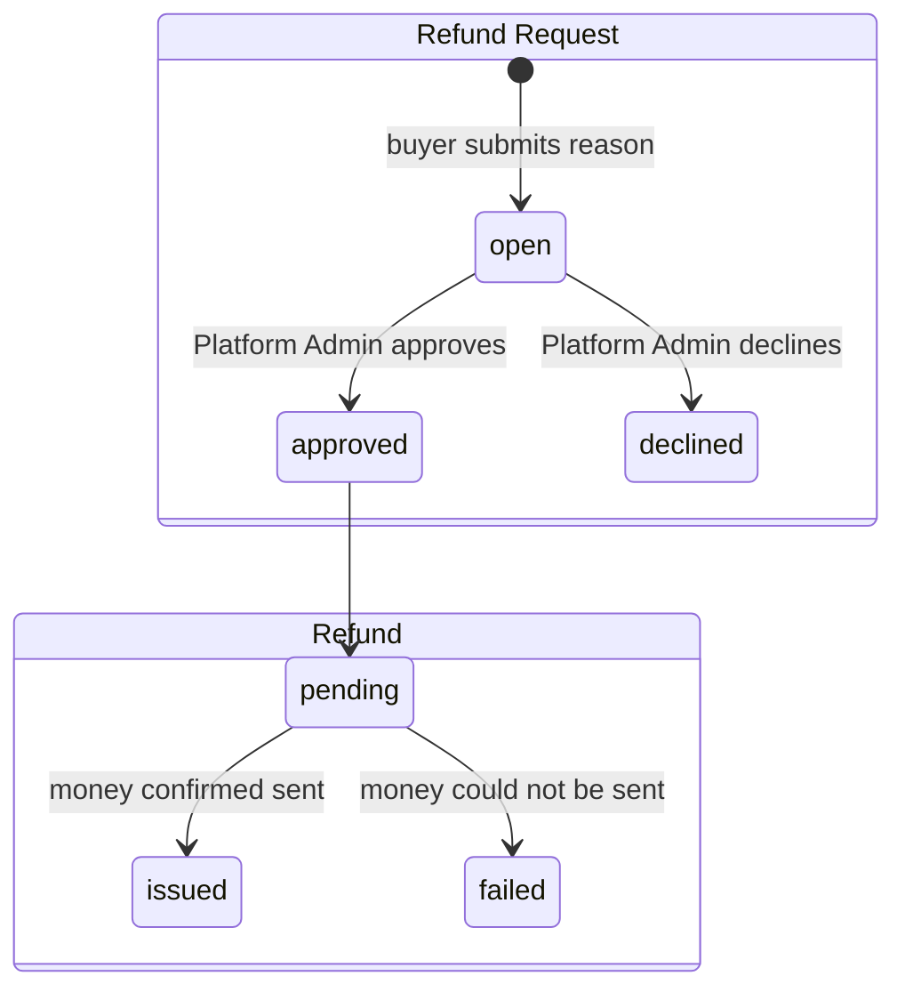

# Refunds

Terms are defined in [`GLOSSARY.md`](../../GLOSSARY.md) (Refunds section).
This page holds what the glossary deliberately leaves out: the rules, the
record, and the names in code.

Two things, not one: the **Refund Request** is the ask and its decision; the
**Refund** is the money that follows an approval. The database stores Refund
Requests. Refunds (Pending / Issued / Failed) are not stored yet — see the
known gap.

## Lifecycle

- One Purchase may have many Refund Requests over time; at most one is `open`.
- A declined request keeps everything the Purchase granted; the buyer may raise
  a new request.
- While a request is open, the buyer keeps their Enrollment and the Team
  Licence's Unclaimed Seats cannot be claimed (`app/routes/redeem.$code.tsx`).
- Approving ends what the Purchase granted (Enrollment, or Unclaimed Seats for
  good). Not implemented yet — known gap.

## Refund Policy

A Purchase can have a Refund Request raised when **all** of these hold. The
first failing rule, in this order, is the reason the buyer sees.

| Rule                  | Value                                                                                         | `RefundIneligibility` |
| --------------------- | --------------------------------------------------------------------------------------------- | --------------------- |
| No open request       | No Refund Request in `open` state exists for this Purchase.                                   | `OpenRefundRequest`   |
| No Claimed Seat       | No Seat from this Team Licence has been claimed.                                              | `ClaimedSeat`         |
| Refund Window         | Today is on or before the 14th calendar day after the purchase day (whole days, not hours).    | `WindowClosed`        |
| Watch Limit           | Watched (furthest position per lesson, summed over the course) is under 2 hours.               | `WatchLimitReached`   |

Lesson completion is deliberately **not** a rule: Watched is the honest measure
of "they've had the course".

`NoPurchase` is returned when the buyer has no Purchase of the course at all.

## Refund amount

Always `purchase.amountPaid`, captured on the Refund Request when it is raised.
Never the course's current price, never more than was paid. Purchasing-Power
Prices need no special case because `amountPaid` is already the discounted
figure.

## Record

Table `refund_requests`:

| Column               | Meaning                                                          |
| -------------------- | ---------------------------------------------------------------- |
| `purchase_id`        | The Purchase the request is about.                               |
| `status`             | `open` \| `approved` \| `declined` (`RefundRequestStatus`).      |
| `reason`             | The buyer's own words.                                           |
| `amount`             | What the Refund will be if approved. Never null.                 |
| `requested_at`       | When the buyer asked.                                            |
| `decided_at`         | When a Platform Admin approved or declined. Null while open.     |
| `decided_by_user_id` | The Platform Admin who decided. Null while open.                 |

## Names

| Thing                   | Name                                                 |
| ----------------------- | ---------------------------------------------------- |
| Route                   | `POST /courses/:slug/refund`                         |
| Policy module           | `app/lib/refunds.server.ts`                          |
| Eligibility             | `getRefundEligibility(userId, courseId)`             |
| Pure rules              | `evaluateRefundPolicy(facts)`                        |
| Open-request check      | `hasOpenRefundRequest(purchaseId)`                   |
| Policy constants        | `REFUND_WINDOW_DAYS`, `WATCH_LIMIT_SECONDS`          |
| Course-page component   | `RequestRefund`                                      |
| Course-page loader data | `refundOffer`                                        |
| Settings loader data    | `openRefundRequests`                                 |
| Email builder           | `buildRefundRequestReceivedEmail`                    |
| Buyer button            | "Request a refund"                                   |
| Settings card           | "Open refund requests" · badge "Open"                |
| Email subject           | "Refund request received — {course title}"           |

## Known gap

No Platform Admin surface decides a Refund Request, so `approved` and
`declined` are reachable only by hand, the consequences of approval (ending the
Enrollment / freezing Unclaimed Seats) are not implemented, and Refunds
themselves (Pending / Issued / Failed) have no record. Tracked as issue #2.
